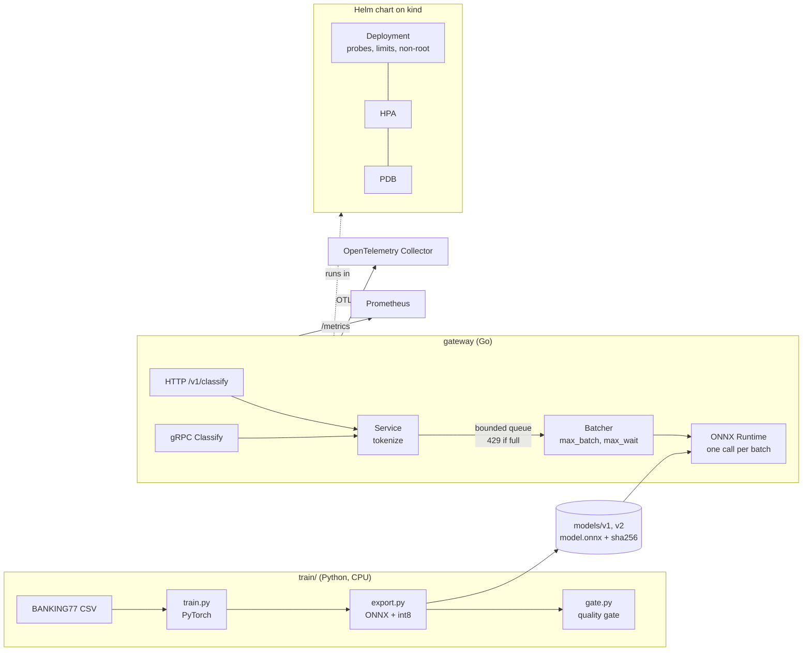

# inference-gateway

A Go service that serves a text classifier to other services with predictable latency.
It routes customer support messages for a bank to one of 77 intents (BANKING77).
A small Python pipeline trains the model on CPU with PyTorch, exports it to ONNX and quantizes it to int8.
The gateway loads the ONNX model, groups requests into micro-batches, refuses work when its queue is full, and offers HTTP and gRPC APIs with Prometheus metrics and OpenTelemetry traces.
A Helm chart runs it on Kubernetes (tested on a local kind cluster).



## Quick start

```bash
scripts/fetch-onnxruntime.sh          # pinned ONNX Runtime 1.31.0, SHA-256 checked
go test -race ./...
go run ./cmd/gateway                  # :8080 HTTP, :9090 gRPC
curl -s -XPOST localhost:8080/v1/classify -d '{"text":"My card has not arrived yet"}'
```

More: [docs/ONBOARDING.md](docs/ONBOARDING.md) (setup and code map), [docs/RUNBOOK.md](docs/RUNBOOK.md) (operating it), [docs/DEMO.md](docs/DEMO.md) (real output), [docs/PERF.md](docs/PERF.md) (numbers), [docs/DECISIONS.md](docs/DECISIONS.md), [SECURITY.md](SECURITY.md), [LEARN.md](LEARN.md) (explains every part in plain language).

## Results (measured 2026-11-07)

| Item | Result |
|---|---|
| Model, official BANKING77 test split (3,080 texts) | macro-F1 0.8636 fp32, 0.8636 int8 (v1); 0.8637 and 0.8629 (v2) |
| Model size | 33.6 MB fp32, 8.4 MB int8 |
| Training time, CPU, 1 thread, 2015 laptop | 321 s (v1), 346 s on a rerun |
| Reproducibility, same seed | macro-F1 identical on rerun (difference 0.0000 points) |
| ONNX fp32 vs PyTorch, 200 samples | max absolute difference 5.1e-07 |
| Go tokenizer vs Python | identical on 500 texts |
| Go inference vs Python ONNX Runtime, 200 samples | same top intent, probabilities within 5e-4 (one text per call; the first CI run on a different CPU differed by 1.09e-4, so the tolerance was widened from 1e-4) |
| Go tests with `-race` | all pass (see "Verification status") |
| Serving, HTTP, this laptop | up to about 10.5k req/s with `max_batch=1`, 11.2k with `max_batch=16`; p50 0.4 ms vs 4 ms at low load |
| Kubernetes on kind (local, rootless podman) | three rolling upgrades under load (v1 to v2, v2 to v1, v1 to v2): 0 non-2xx; HPA desired replicas rose to the maximum of 4; trace tree found |

Details and caveats are in `docs/PERF.md` and `docs/DEMO.md`. Batching raised throughput only near saturation, and by a few percent end to end. At lower load it only added latency.

## API

- `POST /v1/classify` with `{"text": "..."}` returns `{"intent", "probability", "model_version", "top": [3 items]}`.
- gRPC `inference.v1.Gateway/Classify`, see `proto/inference/v1/inference.proto`.
- `GET /healthz` (alive), `GET /readyz` (model loaded and warm), `GET /metrics`.
- 400 for empty text, 429 or `RESOURCE_EXHAUSTED` when the queue is full, 504 or `DEADLINE_EXCEEDED` after the request deadline, 503 during shutdown.

## Verification status (what has and has not been run)

Run locally on 2026-11-07 (Fedora 44, 2015 MacBook Pro, CPU only): training, export, quality gate, reproducibility rerun, all Go tests with the race detector, golangci-lint, `go vet`, k6 load runs, image build with podman, `helm lint`, and the full kind end-to-end script on rootless podman (install, smoke over HTTP and gRPC, HPA, rolling upgrade, readiness check, trace check with an OpenTelemetry Collector).

NOT run yet:

- **GitHub Actions: new jobs.** Past results on `main`, read once from the GitHub API on 2026-11-09 (this read did not start or watch a run):

  | Workflow | Run id | Head commit | Conclusion | Date |
  |---|---|---|---|---|
  | ci | 42445773905 | 0cf6579 | success | 2026-11-08 |
  | ci | 42589487400 | 00ab08a | success | 2026-11-09 |
  | security | 42589487570 | 00ab08a | failure (not examined) | 2026-11-09 |

  The four `ci` jobs were green (checked by the owner on 2026-11-08). The `ci` run on 2026-11-09 only had documentation, the security files and a dependency bump on top. Jobs added after these runs have not been checked: the `rules` job, the SBOM step, the canary test step, `release.yml`, and the fixes to `security.yml`. The first `security` run failed and the reason has not been looked at. Every action version in the new files is unverified.
- **`buf lint`.** `buf` is not packaged in Fedora and this project installs tools only from Fedora. It runs in CI only.
- **`kubeconform -strict`.** Same reason. It runs in CI only. `helm lint` ran locally.
- **Trivy in CI.** A local `trivy image --severity CRITICAL --ignore-unfixed` scan found 0 critical findings (Debian base and Go binary). The `image` CI job has not run.
- **`ghz`.** Not packaged in Fedora. gRPC load used k6's gRPC client instead.
- Docker. Docker is not installed here. CI uses Docker. Local runs used rootless podman.

## What this is not

- **Not GPU serving.** CPU only. No GPU, CUDA, vLLM, Triton or distributed training. Micro-batching is the same idea GPU servers use, shown on CPU.
- **Not a strong model.** A small hashed-feature model (fastText style), 86 percent accuracy, chosen so it trains and serves on a laptop. Not a transformer.
- **Not production Kubernetes.** It runs on a local kind cluster. There is no managed cluster, service mesh, on-call, cluster upgrade or capacity planning. The HPA uses CPU only.
- **Not secured.** No authentication and no TLS. A network boundary is assumed. See `SECURITY.md`.
- **Not a model registry setup.** Model versions are baked into the image and selected by config.
- **Not a benchmark.** Numbers come from one shared 2015 laptop, single runs.
- **Dynamic int8 is batch dependent.** The same text can score slightly differently in different batches (see `docs/DECISIONS.md`).
- Traces were tested against an OpenTelemetry Collector with a file exporter, not a real tracing backend.

## Layout

```
cmd/gateway   cmd/probe          service and test client
internal/     tokenize model batcher server telemetry config
proto/        gRPC API            gen/   generated messages and hand-written gRPC stub
train/        PyTorch, ONNX export, gate, model card
models/       v1 and v2 int8 ONNX models with metrics and model cards
deploy/       Helm chart and e2e manifests
scripts/      onnxruntime fetch, e2e, perf, demo, repro check
loadtest/     k6 scripts
docs/         onboarding, runbook, demo, decisions, perf
```

## Data and license

Data: BANKING77 by PolyAI Ltd, CC BY 4.0, https://github.com/PolyAI-LDN/task-specific-datasets (credit also in `data/README.md` and the model cards).
Code: MIT, copyright Stanley Sujith Nelavala. See `LICENSE`.
