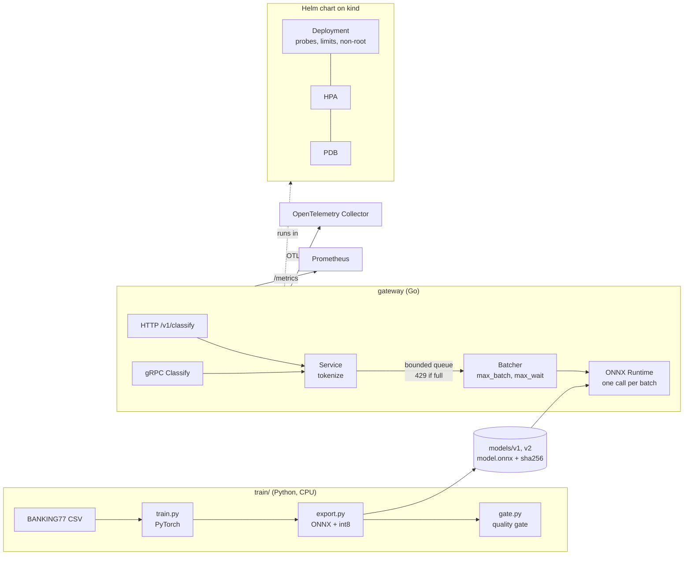

# inference-gateway

A Go service that serves a text classifier to other services with predictable latency.
It routes customer support messages for a bank to one of 77 intents (BANKING77).
A small Python pipeline trains the model on CPU with PyTorch, exports it to ONNX and quantizes it to int8.
The gateway loads the ONNX model, groups requests into micro-batches, refuses work when its queue is full, and offers HTTP and gRPC APIs with Prometheus metrics and OpenTelemetry traces.
A Helm chart runs it on Kubernetes (tested on a local kind cluster).



## Verified locally

Every claim below was run on one laptop (MacBook Pro mid 2015, 8 logical CPUs; measured on one laptop). The load generator shares the machine. Dates are 2026-11-09. The evidence files hold the raw output and the commit.

| Claim | Command | Evidence | Date |
|---|---|---|---|
| Golden-signals dashboard queries return data (the error query had no errors to count), a Grafana screenshot shows all eight panels under load, and one request trace has the spans `POST /v1/classify`, `tokenize`, `queue.wait`, `batch.run` | `scripts/diag-run.sh`; screenshot command in the `.txt` file | `docs/engagement/evidence/diagnostics-stack-run.txt`, `docs/engagement/evidence/grafana-golden-signals.png` and `.txt`, `docs/engagement/evidence/jaeger-request-trace.json` | 2026-11-09 |
| Label sets stay bounded; latency has a `model_version` label; exemplars carry trace ids | `go test -race ./internal/...` | `docs/engagement/TELEMETRY.md` | 2026-11-09 |
| Locust against k6: 3.8 percent below k6 at 2000 rps, 20.3 percent below at 4000 rps (not within the 10 percent margin at 4000) | `scripts/locust-vs-k6.sh` | `docs/engagement/evidence/locust-vs-k6.txt` | 2026-11-09 |
| One-factor experiments with pprof at 6000 rps; the gateway used about 1.2 cores; GC and the tokenizer are ruled out. 6000 rps is below saturation: the runs show where CPU goes and how latency changes, not the maximum throughput | `scripts/experiment.sh` | `docs/engagement/evidence/experiments/README.md` | 2026-11-09 |
| Capacity model: median 5214.3 rps per core of gateway CPU at 6000 rps (below saturation, so a cost per request, not a maximum), 10x launch peak 5208.3 rps, 2 to 3 replicas of 2 cores. The replica range is an estimate with named assumptions in `docs/engagement/CAPACITY.md` (same text mix, same model, CPU class not much slower, load generator not the limit; the high case assumes half the work per core) | `python3 scripts/capacity_model.py --check-doc docs/engagement/CAPACITY.md` | `docs/engagement/evidence/capacity-model-output.txt` | 2026-11-09 |
| Canary with automatic rollback: a healthy canary was promoted through four steps; a canary with 30 percent errors was rolled back at the first step | `scripts/canary-run.sh pass`, `scripts/canary-run.sh fail` | `docs/engagement/evidence/canary-pass.txt`, `docs/engagement/evidence/canary-fail-rollback.txt` | 2026-11-09 |
| Latency SLO alerts behave as written | `promtool test rules` (container image) | `docs/engagement/evidence/promtool-latency-slo.txt` | 2026-11-09 |
| Image SBOM and a release manifest with model and runtime hashes | `scripts/release_manifest.py` | `docs/engagement/evidence/sbom-image.cdx.json`, `release/manifest.json` | 2026-11-09 |
| gitleaks, gosec, govulncheck, pip-audit and Trivy ran locally | see the file | `docs/engagement/evidence/security-gate-local.txt` | 2026-11-09 |
| `podman compose config` and `docker compose config` both pass for the diagnostics stack (Docker Compose 5.6.0 from the Fedora package, not installed system-wide) | see the file | `docs/engagement/evidence/compose-config.txt` | 2026-11-09 |

## Authored, not run

| File | What it would do | Why it did not run |
|---|---|---|
| `.github/workflows/release.yml` | Build, push to GHCR, sign the image with cosign, attach the SBOM, write the release manifest (model and runtime hashes) and sign it with `cosign sign-blob` | Authored, not run: written and syntax-checked with actionlint 1.7.12. Not executed against GitHub Actions. Reason: needs GitHub Actions |
| `.github/workflows/security.yml` (CodeQL job and the others) and the new steps in `ci.yml` | Run the security gate and the rules checks in GitHub Actions | Authored, not run: checked with actionlint. Each `run:` command was run locally once. Past GitHub results are in "Verification status" below. Reason: needs GitHub Actions |
| `docs/engagement/adr/0003-gpu-and-fine-tuning.md` | A decision about GPU serving and fine-tuning | Decision level only. No GPU work was built or measured |

## Quick start

```bash
scripts/fetch-onnxruntime.sh          # pinned ONNX Runtime 1.31.0, SHA-256 checked
go test -race ./...
go run ./cmd/gateway                  # :8080 HTTP, :9090 gRPC
curl -s -XPOST localhost:8080/v1/classify -d '{"text":"My card has not arrived yet"}'
```

More: [docs/ONBOARDING.md](docs/ONBOARDING.md) (setup and code map), [docs/RUNBOOK.md](docs/RUNBOOK.md) (operating it), [docs/DEMO.md](docs/DEMO.md) (real output), [docs/PERF.md](docs/PERF.md) (numbers), [docs/DECISIONS.md](docs/DECISIONS.md), [SECURITY.md](SECURITY.md), [LEARN.md](LEARN.md) (explains every part in plain language).

## Results (measured 2026-11-07)

| Item | Result |
|---|---|
| Model, official BANKING77 test split (3,080 texts) | macro-F1 0.8636 fp32, 0.8636 int8 (v1); 0.8637 and 0.8629 (v2) |
| Model size | 33.6 MB fp32, 8.4 MB int8 |
| Training time, CPU, 1 thread, 2015 laptop | 321 s (v1), 346 s on a rerun |
| Reproducibility, same seed | macro-F1 identical on rerun (difference 0.0000 points) |
| ONNX fp32 vs PyTorch, 200 samples | max absolute difference 5.1e-07 |
| Go tokenizer vs Python | identical on 500 texts |
| Go inference vs Python ONNX Runtime, 200 samples | same top intent, probabilities within 5e-4 (one text per call; the first CI run on a different CPU differed by 1.09e-4, so the tolerance was widened from 1e-4) |
| Go tests with `-race` | all pass (see "Verification status") |
| Serving, HTTP, this laptop | up to about 10.5k req/s with `max_batch=1`, 11.2k with `max_batch=16`; p50 0.4 ms vs 4 ms at low load |
| Kubernetes on kind (local, rootless podman) | three rolling upgrades under load (v1 to v2, v2 to v1, v1 to v2): 0 non-2xx; HPA desired replicas rose to the maximum of 4; trace tree found |

Details and caveats are in `docs/PERF.md` and `docs/DEMO.md`. Batching raised throughput only near saturation, and by a few percent end to end. At lower load it only added latency.

## API

- `POST /v1/classify` with `{"text": "..."}` returns `{"intent", "probability", "model_version", "top": [3 items]}`.
- gRPC `inference.v1.Gateway/Classify`, see `proto/inference/v1/inference.proto`.
- `GET /healthz` (alive), `GET /readyz` (model loaded and warm), `GET /metrics`.
- 400 for empty text, 429 or `RESOURCE_EXHAUSTED` when the queue is full, 504 or `DEADLINE_EXCEEDED` after the request deadline, 503 during shutdown.

## Verification status (what has and has not been run)

Run locally on 2026-11-07 (Fedora 44, 2015 MacBook Pro, CPU only): training, export, quality gate, reproducibility rerun, all Go tests with the race detector, golangci-lint, `go vet`, k6 load runs, image build with podman, `helm lint`, and the full kind end-to-end script on rootless podman (install, smoke over HTTP and gRPC, HPA, rolling upgrade, readiness check, trace check with an OpenTelemetry Collector).

NOT run yet:

- **GitHub Actions: new jobs.** Past results on `main`, read from the GitHub API on 2026-11-09 at about 12:15 UTC (read only; this did not start or watch a run):

  | Workflow | Run id | Head commit | Conclusion | Date |
  |---|---|---|---|---|
  | ci | 42445773905 | 0cf6579 | success | 2026-11-08 |
  | ci | 42589487400 | 00ab08a | success | 2026-11-09 |
  | security | 42589487570 | 00ab08a | failure (jobs `deps` and `image`) | 2026-11-09 |
  | ci | 42611746329 | b673686 | failure (`TestParityWithPython`, see below) | 2026-11-09 |
  | security | 42611746538 | b673686 | failure (jobs `deps` and `image`) | 2026-11-09 |
  | ci | 42612800931 | 7f6acdb | success | 2026-11-09 |
  | security | 42612800796 | 7f6acdb | failure (jobs `deps` and `image`) | 2026-11-09 |
  | security | 42614301665 | a42aa02 | failure (jobs `deps` and `image`) | 2026-11-09 |

  The four `ci` jobs were green (checked by the owner on 2026-11-08). In every `security` run the jobs `codeql`, `secrets`, `sast`, `sbom` and `exceptions` passed. Two jobs failed, for two causes found in the failed-step logs:
  1. `deps`: `actions/setup-go` read `go 1.26.0` from `go.mod` and installed Go 1.26.0. `govulncheck` then reported standard library issues that later 1.26 patches fix. The local run used Go 1.26.10 and found none. Fix: the security jobs now ask for the latest 1.26 patch (`go-version: "1.26.x"`, `check-latest: true`).
  2. `image`: Trivy found `libssl3` CVE-2026-84782 in the distroless base. This finding is in `security/exceptions.json`, but the job did not give the exceptions to Trivy. Fix: the job now checks the exceptions file, writes the Trivy ids to an ignore file and passes `--ignorefile`. The Trivy install script and binary are pinned to v0.69.3.

  The `security` run after these fixes has not been checked here. One `ci` run failed in `TestParityWithPython`: on that runner the Go and Python probabilities differed by 1.53e-3 for one text, above the 5e-4 tolerance. The runs before and after passed on the same code, so the result depends on the runner CPU. The tolerance is unchanged. Every action version in the new files is unverified.
- **`buf lint`.** `buf` is not packaged in Fedora and this project installs tools only from Fedora. It runs in CI only.
- **`kubeconform -strict`.** Same reason. It runs in CI only. `helm lint` ran locally.
- **Trivy in CI.** The `image` job of `ci.yml` (CRITICAL only) passed in the `ci` runs above. The HIGH scan in `security.yml` is described above.
- **`ghz`.** Not packaged in Fedora. gRPC load used k6's gRPC client instead.
- Docker. Docker is not installed here. CI uses Docker. Local runs used rootless podman.

## What this is not

- **Not GPU serving.** CPU only. No GPU, CUDA, vLLM, Triton or distributed training. Micro-batching is the same idea GPU servers use, shown on CPU.
- **Not a strong model.** A small hashed-feature model (fastText style), 86 percent accuracy, chosen so it trains and serves on a laptop. Not a transformer.
- **Not production Kubernetes.** It runs on a local kind cluster. There is no managed cluster, service mesh, on-call or cluster upgrade. Capacity planning is only the one-laptop model in `docs/engagement/CAPACITY.md`. The HPA uses CPU only.
- **Not secured.** No authentication and no TLS. A network boundary is assumed. See `SECURITY.md`.
- **Not a model registry setup.** Model versions are baked into the image and selected by config.
- **Not a benchmark.** Numbers come from one shared 2015 laptop, single runs.
- **Dynamic int8 is batch dependent.** The same text can score slightly differently in different batches (see `docs/DECISIONS.md`).
- Traces were tested against an OpenTelemetry Collector with a file exporter, not a real tracing backend.

## Layout

```
cmd/gateway   cmd/probe          service and test client
internal/     tokenize model batcher server telemetry config
proto/        gRPC API            gen/   generated messages and hand-written gRPC stub
train/        PyTorch, ONNX export, gate, model card
models/       v1 and v2 int8 ONNX models with metrics and model cards
deploy/       Helm chart and e2e manifests
scripts/      onnxruntime fetch, e2e, perf, demo, repro check
loadtest/     k6 scripts
docs/         onboarding, runbook, demo, decisions, perf
```

## Data and license

Data: BANKING77 by PolyAI Ltd, CC BY 4.0, https://github.com/PolyAI-LDN/task-specific-datasets (credit also in `data/README.md` and the model cards).
Code: MIT, copyright Stanley Sujith Nelavala. See `LICENSE`.
