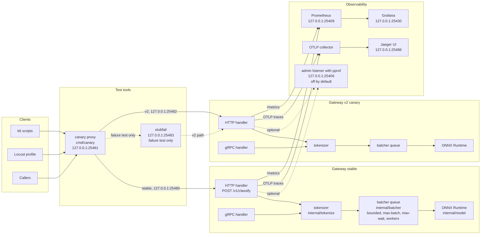

# Architecture

This page shows the request path and the telemetry path of the gateway. It also lists the trust boundaries of the test setup.

## Component flow

## Trust boundaries

- No authentication. Any caller that reaches a port can send requests.
- No TLS. HTTP and gRPC run in plaintext.
- All ports in the compose file bind to 127.0.0.1. The setup is local only.
- The admin pprof listener is off by default. When it is on, it must stay on loopback.
- The canary proxy and stubfail are test tools. Do not deploy them.

## Components

### Clients

k6 scripts, the Locust profile and direct callers send classify requests. They talk to the canary proxy, not to the gateway directly.

### Canary proxy

`cmd/canary` listens on 127.0.0.1:25481. It splits traffic between the stable gateway on 127.0.0.1:25480 and gateway v2 on 127.0.0.1:25482. It sets the v2 weight to 0 when the error rate or p95 crosses the gate. It is a test tool.

### stubfail

A stub that returns errors. It sits in front of v2 in the failure test only. It forces the canary gate to trip so the rollback path is proven.

### Gateway

The gateway has two entry points: the HTTP handler (`POST /v1/classify`) and the gRPC handler. Both call the tokenizer in `internal/tokenize`. The tokenizer turns text into token ids. The batcher queue in `internal/batcher` holds the requests. The queue is bounded by `QUEUE_SIZE`. The batcher groups requests by `MAX_BATCH` and `MAX_WAIT` and runs them on `WORKERS` goroutines. Each batch runs on ONNX Runtime through `internal/model`.

### Prometheus and Grafana

The gateway exposes `/metrics` on 127.0.0.1:25409. Prometheus scrapes it. Grafana on 127.0.0.1:25430 shows the golden signals: latency p50, p95 and p99, traffic, errors and sheds, and saturation.

### Collector and Jaeger

The gateway sends OTLP traces to the collector when `OTEL_EXPORTER_OTLP_ENDPOINT` is set. The collector forwards them to Jaeger. The Jaeger UI is on 127.0.0.1:25486.

### Admin listener

The admin listener serves pprof on 127.0.0.1:25406. It is off by default. Turn it on only for a profiling run, and keep it on loopback.

## Span names

One request produces these spans:

- `POST /v1/classify`: the HTTP handler span.
- `tokenize`: the tokenizer span.
- `queue.wait`: the time a request waits in the batcher queue.
- `batch.run`: the time one batch spends in ONNX Runtime.
